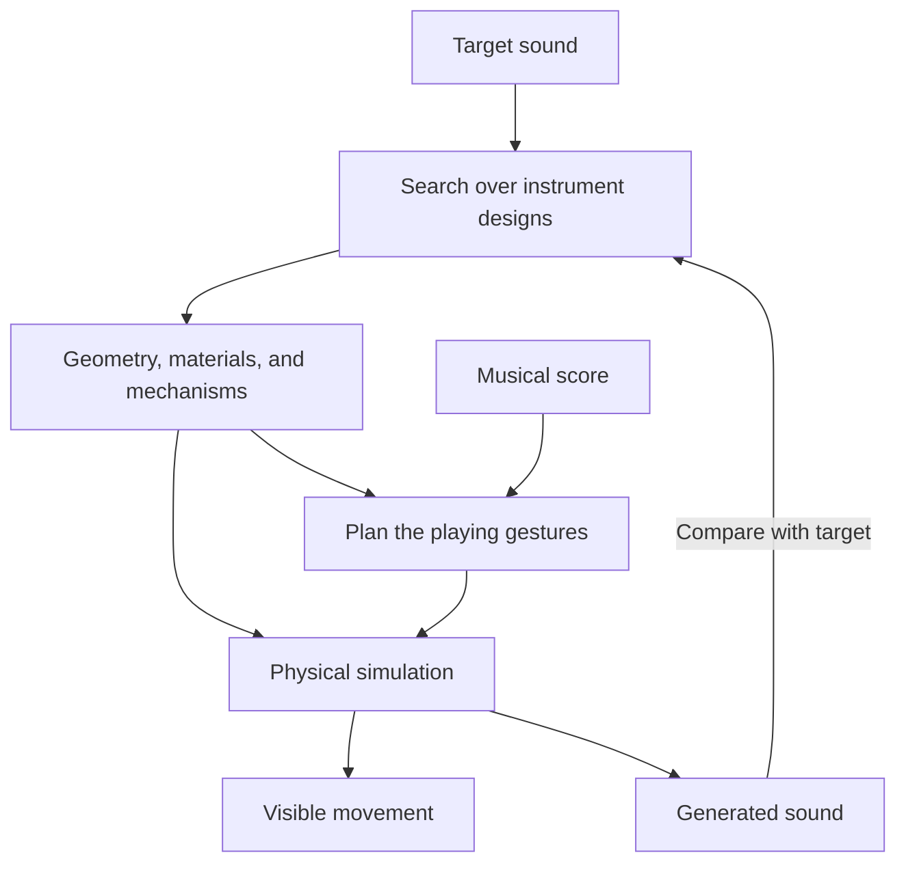

I’m really curious of the Animusic videos that feature 3d renderings of music being played by machines or other kinds of other worldly agents. I’m curious how they even did these from the era they did. Ultimately, I think it would be amazing to create a procedural kind of program that can create these videos and have some sort of physical realism to how the sounds work as 3d physical instruments. Think the physics of all acoustic instruments, but then extrapolating how a synthesizer creates sounds, but reverse engineering the mathematics of what the synthesizer does to approximate an actual physical instrument of the sounds. This would be wildly creative and have infinite possibilities, but so incredible.

**Yes—there is a technically credible path toward what you’re imagining: a program that invents a playable physical body for a sound.** The most compelling version would let the same simulated mechanism produce both the music and the visible movement. Change the instrument’s shape, move a support, or strike a different place, and you would hear the consequences.

There are already substantial pieces of this in musical acoustics and computer graphics. What makes your proposal especially interesting is bringing them together: procedural instrument design, sound synthesis, mechanical choreography, and a world in which the audience can see how the music happens.

And Animusic itself was already surprisingly procedural. Its creators solved a different part of this problem with considerable ingenuity.

## 1. How Animusic worked so early

The history goes back even earlier than the familiar DVDs. Wayne Lytle’s *More Bells and Whistles* appeared at SIGGRAPH in **1990**. The SIGGRAPH program for *Pipe Dream* in 2001 describes software that analyzed the music and automatically moved the instruments, with essentially no traditional keyframing for that performance. [history.siggraph.org](https://history.siggraph.org/wp-content/uploads/2021/05/SVR-Issue-138-2001-Electronic-Theater.pdf?utm_source=chatgpt.com)

The central insight was to use **MIDI as a plan for the animation**.

A MIDI sequence provides structured musical events: which note happens, when it begins, how long it lasts, and its velocity. Animusic’s proprietary **MIDImotion** software processed that information to generate movement. Crucially, it could consider the recent past and upcoming notes as well as the present moment. That let it plan the approach to a strike, the strike itself, and the recovery afterward. [Animation World Network](https://www.awn.com/animationworld/mix-and-match-animation-techniques?utm_source=chatgpt.com)

Imagine a ball that must hit a metal bar at precisely 12 seconds. If its planned flight takes 0.45 seconds, the system schedules its launch at 11.55 seconds. The animation can establish a visible cause before the sound occurs because it knows the score ahead of time.

That is a large part of the feeling you get from Animusic: you can watch an event approaching and anticipate its musical consequence.

The production combined that software with substantial human design work. Dave Crognale’s own portfolio identifies **3D Studio Max** as part of the first album’s production and credits his modeling, shading, lighting, secondary animation, and camera work. Lytle handled the composition, sequencing, music animation software, and much of the overall conception and direction. [David M. Crognale](https://www.gigabeard.com/main-works/world-builder/a1-dvd-se/?utm_source=chatgpt.com)

It also benefited from **offline rendering**. A computer could spend much longer calculating a frame than the fraction of a second for which that frame would eventually appear. The finished video played smoothly even if making it was slow. Lytle said each of the first two DVDs took approximately three years to produce. [MIDI.org](https://midi.org/animusic-midi-driven-computer-animation?utm_source=chatgpt.com)

There is one crucial distinction for your idea: **the depicted objects were not generally acoustic simulations generating the soundtrack**. Lytle described the music as synthesized, with the graphical instruments designed to create the illusion that they produced it. The animation supplied extremely convincing musical causality. [Animation World Network](https://www.awn.com/animationworld/mix-and-match-animation-techniques?utm_source=chatgpt.com)

Your proposal would extend that connection all the way into the sound-producing physics.

## 2. The sound and the image could share one physical model

The technical foundation is **physical modeling synthesis**: computing sound by simulating an excited, vibrating system.

A useful starting vocabulary is:

| Part of the instrument | What it does                             | Possible examples                                         |
| ---------------------- | ---------------------------------------- | --------------------------------------------------------- |
| **Exciter**            | Supplies energy                          | Hammer, pick, bow, air jet, reed, motor                   |
| **Resonator**          | Vibrates in characteristic ways          | String, tine, plate, membrane, tube, cavity               |
| **Connections**        | Transfer energy between parts            | Bridge, joint, spring, contact surface, air passage       |
| **Losses and damping** | Determine how vibration dies away        | Material losses, felt contacts, friction                  |
| **Sound output**       | Converts vibration into the heard signal | A modeled pickup, vibrating surface, or radiating opening |

Environments such as IRCAM’s **Modalys** already build virtual instruments from physical objects and interactions of this kind. Its components include strings, plates, tubes, membranes, masses, and springs, as well as more complex resonators derived from 3D meshes. [Ircam Forum](https://forum.ircam.fr/projects/detail/modalys/?utm_source=chatgpt.com)

For a simplified elastic object, a starting equation is:

M\ddot{x}+C\dot{x}+Kx=F(t)

Here, x describes its vibration, M its mass distribution, C its damping, K its stiffness, and F(t) the forces used to play it. Geometry and material properties help determine those quantities. More elaborate instruments require nonlinear contact, friction, airflow, and other interactions, but this gives a concrete foundation. Geometry-to-vibration calculations of this kind are part of research systems such as DiffSound. [arxiv.org](https://arxiv.org/html/2409.13486v1?utm_source=chatgpt.com)

The powerful consequence is that this simulated state can supply two outputs:

- **Visible movement:** how the body deforms, how a string moves, how a membrane vibrates.
- **Sound:** a signal derived from that vibration, through a modeled pickup or an acoustic radiation model.

Those outputs have a shared cause.

There is a useful distinction even within that last step. Reading the velocity of a vibrating point can serve as a virtual contact pickup. Predicting what a microphone hears some distance away requires additional modeling of how the object radiates sound into the surrounding air. I would make that choice explicit in the program, because both are useful but establish different levels of acoustic realism.

### Why this does not require simulating every particle

One especially useful method is **modal synthesis**. An object’s vibration can be represented using a set of characteristic vibration patterns, called modes. Each has a frequency and a spatial shape. Combining their changing amplitudes reconstructs the object’s movement. Digital waveguides provide another efficient approach, particularly for strings and acoustic tubes. [Next Generation Sound Synthesis](https://www.ness.music.ed.ac.uk/project.html?utm_source=chatgpt.com)

That is a beautiful bridge between your two interests:

**A musical partial can correspond to a particular way the object is moving.**

You could inspect a strange instrument and see where its low resonance lives, where its bright metallic overtones live, and which connection causes energy to move between them. The same model that makes the sound could reveal its anatomy.

## 3. Reverse engineering a synth sound would really be instrument design

This is the most important conceptual adjustment I would make to your proposal:

**Treat the synthesized sound as a design requirement. Search for physical instruments that could approximate it.**

There will usually be many possible solutions. A recording contains the combined effects of an excitation, a resonating structure, how it was played, and how it was heard. Those do not generally identify a unique object.

There is even a precise mathematical illustration: distinct idealized drum shapes can share the same set of vibration frequencies. That does not mean every recording of them would be identical, but it establishes that knowing the resonances alone cannot always recover a unique shape. [arxiv.org](https://arxiv.org/abs/math/9207215?utm_source=chatgpt.com)

For your creative goal, that ambiguity is valuable.

A particular metallic synth pluck might lead to several candidate inventions:

- A branching array of metal tines.
- A hollow body with carefully shaped internal ribs.
- Several strings coupled through a moving bridge.
- A collection of small resonators that exchange energy through flexible joints.

The program could present these as different answers to the same musical question.

You could then choose among them based on their sound, visual character, responsiveness, or the kind of performance they invite. A sound might have several possible anatomies.

### The instrument must work beyond one recording

Matching one note is a weak test. An optimizer could find a configuration that reproduces that note surprisingly well while behaving poorly everywhere else.

I would ask the system to match a small collection of examples:

- Several pitches.
- Soft and hard attacks.
- Short and sustained articulations.
- Relevant modulation or parameter changes.
- Repeated notes while previous vibrations are still decaying.

Then I would play it in ways the fitting process had never encountered.

**If it responds coherently to a new strike location, a different gesture, or a structural edit, we have begun to create an instrument with its own behavior.**

This also keeps the visual identity stable. A playable instrument should have a sensible way to change pitch or articulation; it should not need an unrelated new body for every note.

## 4. How synthesizer mathematics could acquire physical mechanisms

There are several promising routes. These are design directions I would explore, with the understanding that each needs testing against the target sound.

| Synthesis idea            | A possible physical interpretation                                                                                                    | The main challenge                                                                                                                              |
| ------------------------- | ------------------------------------------------------------------------------------------------------------------------------------- | ----------------------------------------------------------------------------------------------------------------------------------------------- |
| **Additive synthesis**    | Multiple tuned resonators contribute different partials: reeds, tines, strings, cavities, or modes of one body.                       | A real body constrains which combinations of frequencies, amplitudes, and decay times are possible. A multipart instrument offers more freedom. |
| **Subtractive synthesis** | A rich excitation passes through resonant cavities, passages, membranes, or other filtering structures.                               | Physical sources and filters can interact in both directions, affecting each other’s behavior.                                                  |
| **FM / phase modulation** | One moving component changes another’s tension, stiffness, boundary position, or oscillation rate.                                    | Reproducing a particular operator relationship requires a suitable coupling mechanism and energy source.                                        |
| **Wavetable synthesis**   | A shaped cam, rotating valve, or driven mechanism creates a repeating motion or pressure pattern.                                     | Complicated waveforms and morphs may demand extreme motion or elaborate active control.                                                         |
| **Granular synthesis**    | Many small impacts, plucks, friction events, or releases of resonant energy combine into a texture.                                   | Arbitrary recorded grains need their own sound-producing explanation; tiny impacts naturally cover only part of granular synthesis’s range.     |
| **Envelopes**             | Attack comes from the excitation, decay from losses, sustain from continued energy, and release from stopping or damping that energy. | Every part of the envelope needs an appropriate physical action.                                                                                |

Two of these are especially rich.

### FM could become moving tension and changing coupling

Suppose a string is mounted on a bridge that another component moves rapidly. That movement changes the string’s tension, which changes its frequency. Now one vibration is influencing another vibration’s timing.

There is an actual acoustic precedent here: David Politzer’s research on banjo timbre describes how motion of the bridge on the drumhead can stretch the strings and modulate their frequencies at audio rates. He proposes this as an important contributor to the instrument’s characteristic sound, while noting that a complete realistic model remains challenging. [arxiv.org](https://arxiv.org/abs/1406.4907?utm_source=chatgpt.com)

That suggests an imaginative design space: instruments in which one part plays another part by changing its physical conditions.

A hypothetical FM-like machine could contain:

- A primary string or blade producing the main tone.
- A second resonator moving its support.
- An adjustable coupling that changes how strongly the motion transfers.
- A powered actuator or excitation that controls how long the interaction continues.

Its physical behavior would likely give the sound additional character. That could be one of the most rewarding outcomes of the project: a familiar synth patch becoming something with resistance, interaction, and surprises.

### Filter sweeps could become changing acoustic spaces

A changing filter could inspire a system of moving cavities, openings, and passages. The audience could see chambers expand, shutters move, or connections between resonators change.

This has a concrete research foundation. **Acoustic Voxels**, a SIGGRAPH 2016 project, optimized assemblies of geometric acoustic components to achieve desired filtering properties. The researchers validated the results with measurements and demonstrated applications including wind instrument prototyping. [Disney Research Studios](https://studios.disneyresearch.com/2016/07/11/acoustic-voxels-computational-optimization-of-modular-acoustic-filters/?utm_source=chatgpt.com)

That does not establish an exact mechanical counterpart for every synthesizer filter. It does show that **a desired acoustic transformation can guide the design of a physical shape**.

For your program, a synth’s modulation could therefore become part of the instrument’s visible performance. A brightening note might involve a changing air path or a damper lifting away, with the audible change computed from that mechanism.

## 5. There are already striking demonstrations of pieces of this

Three projects are particularly relevant.

### Computational Design of Metallophone Contact Sounds

This [2015 research project](https://gauravbharaj.github.io/papers/cdmcs_sa_2015/index.html) optimized object shapes to produce selected frequencies and amplitudes when struck. Its demonstrations included animal-shaped metal keys, three-dimensional cups, and objects designed to produce chords. The page includes demonstration videos. [gauravbharaj.github.io](https://gauravbharaj.github.io/papers/cdmcs_sa_2015/index.html?utm_source=chatgpt.com)

This is one of the closest concrete examples to the heart of your idea:

**Choose aspects of a sound, then alter the object until its physical vibration approaches them.**

Its scope was constrained impact sounds, but it demonstrates that sound-directed shape design can produce actual objects.

### DiffSound

[DiffSound](https://hellojxt.github.io/DiffSound/), presented at SIGGRAPH 2024, connects physical geometry and material parameters to sound through a differentiable simulation. That allows optimization to work backward from sound toward properties of the sounding object.

Its experiments address constrained inference problems, including material, geometry, and impact location. The authors also identify difficulties with thin shells, strongly nonlinear sounds, and computational speed. It provides a relevant research foundation; turning this into a general instrument inventor would require substantial further work. [arxiv.org](https://arxiv.org/html/2409.13486v1?utm_source=chatgpt.com)

### Modalys—and something you can explore in Logic

[Modalys](https://forum.ircam.fr/projects/detail/modalys/) is probably the closest established environment to the idea of assembling unusual virtual instruments from physical components. Its documentation also includes a companion viewer for meshes and animated vibration modes. [Ircam Forum](https://forum.ircam.fr/projects/detail/modalys/?utm_source=chatgpt.com)

Since you use Logic, **Sculpture** is an immediately accessible way to experiment with part of the underlying idea. It generates sound from a modeled vibrating string and lets you vary excitation and physical behavior. Apple explicitly describes using it to create unusual hybrid instruments. It also includes conventional synthesis and effects stages, so its output is not a complete geometric acoustic simulation, but it is a useful way to feel how physical parameters become musical controls. [Apple Support](https://support.apple.com/guide/logicpro/sculpture-overview-lgsia12ea31/mac?utm_source=chatgpt.com)

These examples make me comfortable saying that the foundations are real. The ambitious part is integrating them into a flexible, automatic system that creates coherent instruments and compelling performances.

## 6. How I would organize the program

I would make the central asset a **description of the instrument**, containing its sounding geometry, material properties, connections, excitation mechanisms, and allowed controls.

The audio engine and visual renderer would both read that description.

The relationship could look like this:

There are several distinct jobs inside that system.

### A. Propose a physical construction

I would start with a vocabulary of well-understood parts: strings, beams, plates, membranes, tubes, cavities, and a few excitation types.

The generator could assemble and vary these into candidates. It might change a tine’s thickness profile, connect two plates, move a support, or add a cavity.

This offers enormous variety while retaining a relationship between what is modeled and what is heard. The existing [Faust physical modeling library](https://faustlibraries.grame.fr/libs/physmodels/) illustrates the range of reusable building blocks available, including string and wind models, exciters, waveguides, and modal percussion. [Faust Libraries](https://faustlibraries.grame.fr/libs/physmodels/?utm_source=chatgpt.com)

### B. Fit the construction to the sound

For each candidate, the program would simulate several gestures, compare the resulting audio with the targets, and adjust its parameters.

The comparison should include things such as pitch, spectral shape, attack, decay, noise, and how the timbre evolves. A sound can share average spectral content with another while feeling very different in motion.

I would also include penalties for unnecessary complexity or extreme physical parameters. Otherwise, a search could achieve a closer match by producing a mechanism that is visually unreadable or awkward to play.

Machine learning could help propose candidates and navigate the search. Differentiable DSP provides an established framework for learning controls of structured sound-producing components. However, the choice of components matters: a learnable synthesizer becomes a physical model only when its parameters and behavior are meaningfully constrained by the modeled mechanism. [magenta.tensorflow.org](https://magenta.tensorflow.org/ddsp?utm_source=chatgpt.com)

### C. Plan a performance the mechanism can execute

This is where Animusic’s insight becomes essential.

A MIDI note expresses a desired musical event. A physical player needs an approach, contact, force, and recovery. The planner would consider reach, travel time, rebound, and the number of available actuators.

If one arm cannot reach two distant notes in time, the design could gain another arm, rearrange its playing surfaces, or use a different excitation method.

I particularly like the possibility that **the music could help determine the anatomy of the machine that plays it**. A dense passage might favor multiple independent strikers. A long expressive phrase might favor a continuously moving bow or air source.

### D. Make the physics visually understandable

Audio and video operate on very different time scales. For an illustrative system running audio at 48,000 samples per second and video at 60 frames per second, there are 800 audio samples per video frame. The actual solver may need its own internal time step, but the mismatch remains.

A string vibrating hundreds of times per second will not show up as a leisurely visible wave. The visual design would therefore use a combination of:

- Ordinary visible gestures, such as striking, bowing, and opening valves.
- Motion blur or an envelope showing the extent of vibration.
- Optional enlarged deformation.
- A clearly identified slow-motion inspection view.

The sound-producing state would remain authoritative. The display would make that state legible.

### E. Give the instrument a world and a personality

After the sound and performance work, the system could develop the surrounding visual language: mechanical, botanical, crystalline, aquatic, anatomical, or something harder to classify.

But sounding geometry needs special treatment. A beautiful added branch could alter mass, stiffness, and vibration if it is physically attached. The design process would need to carry those consequences through.

This constraint could actually help the art. The form would acquire reasons for being the way it is.

## 7. How much physical realism would be useful?

I think your phrase “some sort of physical realism” leaves room for an especially productive choice.

There are at least three possible standards:

| Standard                                   | What the system promises                                                                                                                |
| ------------------------------------------ | --------------------------------------------------------------------------------------------------------------------------------------- |
| **Buildable instrument**                   | Plausible materials, dimensions, stresses, supports, and excitation mechanisms that might be fabricated.                                |
| **Consistent virtual instrument**          | Coherent physical equations and explicit energy sources, with freedom to use unusual dimensions or material parameters.                 |
| **Fantasy instrument with declared rules** | A more invented world whose behavior remains internally consistent, even when its materials or interactions go beyond ordinary physics. |

I would begin with **consistent virtual instruments**.

That gives us permission to explore extraordinary constructions without immediately solving manufacturing, durability, or practical assembly. It also gives us a clear standard: the visible mechanism must explain the modeled vibration and its sound.

Powered instruments would belong naturally in this world. Bowing, pumping, motorized movement, and electromagnetic actuation can sustain or transform vibration. For a machine or otherworldly performer, those energy sources could become some of its most expressive visible features.

There is also a creative decision about the target audio. If preserving an original synth recording exactly is essential, the physical instrument may only approximate its behavior. If we let the physical model produce the final performance, it can bring its own response and timbre to the composition. I suspect that second possibility is where many of the most interesting discoveries would happen.

## 8. The first experiment I would actually choose

I would begin with **one invented metal tine or plate that approximates a short synthetic pluck**.

That is small enough to evaluate honestly and rich enough to demonstrate the idea.

The experiment would have five parts:

1. **Choose a target sound.** A metallic, decaying note with a handful of clear partials would be a useful starting point.
2. **Define a family of physical shapes.** For example, a supported tine whose length, thickness profile, material properties, and damping can vary.
3. **Search for a close response.** Adjust those properties and the strike to approach the target.
4. **Animate its actual performance.** Show the striker, contact, vibration, and decay using the simulated state.
5. **Explore the invented instrument.** Move the strike, alter the support, change its shape, and play a phrase.

The last step is the most revealing. It asks whether the result has an intelligible physical identity and useful musical possibilities beyond the sound that inspired it.

After that, I would expand into families of resonators, sustained excitation, nonlinear interactions, and more elaborate performers. We could retain a fast preview mode while allowing expensive fitting and final video rendering to happen offline.

The deepest creative possibility, to me, is that this could become a way to **compose through instrument invention**. You could start with a sound, discover several bodies that approach it, choose one, and then learn what else that body can do.

Imagine a slowly evolving chord played by a cluster of flexible metal leaves. Each leaf has its own resonances; their supports transfer vibration; small moving contacts change which frequencies survive. As the chord brightens, you can watch the mechanism responsible. When you change one connection, an unexpected new voice appears.

That would give the music an observable structure—and give the instrument enough independent behavior that making the video could also become a process of discovering the music.